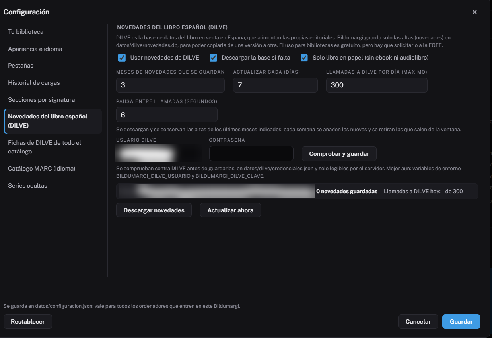
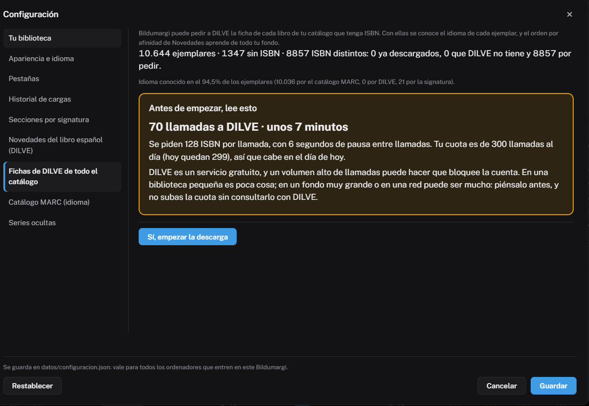

# DILVE

DILVE es la base de datos del libro en venta en España, que alimentan las
editoriales. Bildumargi la usa para:

- las [Sugerencias de compra](../uso/sugerencias-compra.md) y las
  [Novedades](../uso/novedades.md);
- las [Series](../uso/series.md) y los tomos que faltan;
- el **idioma** de los ejemplares (junto con el [catálogo MARC](catalogo-marc.md));
- el orden «Afines a lo que más se presta», que aprende de las fichas de tu
  fondo.

## Solicitar el acceso

El uso para bibliotecas es **gratuito**, pero hay que solicitarlo a la
Federación de Gremios de Editores de España (FGEE), que asigna un usuario y
una contraseña. **Cada biblioteca necesita su propia cuenta.**

## Configurar

En el instalador de Windows, o después en [Configuración](../uso/configuracion.md),
apartado **Novedades del libro español (DILVE)**:

- **Usuario y contraseña.** Se comprueban contra DILVE antes de guardarlos.
- **Ventana**: cuántos meses de novedades se guardan (3 por defecto). Se
  actualiza sola cada 7 días.
- **Solo papel**: opcional.
- **Máximo de llamadas al día y pausa entre llamadas**: el freno (ver abajo).

En un servidor también se pueden poner en `/etc/bildumargi/secretos.env`
(ver [Instalar en un servidor Linux](instalar-servidor.md)).

!!! info "El primer día"
    Con una cuenta nueva, Bildumargi descarga las novedades de los últimos
    meses por su cuenta: unas 200 llamadas. Si ese día también descargas las
    fichas del catálogo, puede que no quepa todo; lo que falte se pide al día
    siguiente.

## Fichas de todo el catálogo

Bildumargi puede pedir a DILVE la ficha de **cada libro de tu catálogo que
tenga ISBN**. Con ellas se conoce el idioma de cada ejemplar, se detectan las
series y el orden por afinidad aprende de todo tu fondo.

Se hace desde **Configuración → Fichas de DILVE de todo el catálogo**, o desde
el aviso que aparece si se conoce el idioma de poco fondo. **Nunca empieza
sola**: primero enseña las cifras con un aviso bien visible y solo empieza si
confirmas.

DILVE admite 128 ISBN por llamada. Como orientación:

| Fondo | ISBN | Llamadas | Tiempo |
|---|---|---|---|
| Biblioteca pequeña | 9.000 | unas 70 | unos 7 minutos, el mismo día |
| Biblioteca grande | 100.000 | unas 780 | **unos 3 días** con la cuota de 300 |
| Red entera | 1.000.000 | unas 8.000 | **casi un mes**: no es recomendable |

Se puede **parar** y seguir otro día: lo descargado se conserva y no se vuelve
a pedir.

## Uso prudente

Un volumen alto de llamadas puede hacer que DILVE bloquee la cuenta.
Bildumargi lo limita:

- **Nada se pide dos veces**: todo lo descargado se guarda. Los ISBN que DILVE
  no tiene se apuntan y no se vuelven a pedir en 60 días.
- **Cuota diaria y pausa**: 300 llamadas al día y 6 segundos entre llamadas
  por defecto. Al llegar al tope, lo que falte se pide al día siguiente.
- **Contraseña incorrecta**: deja de llamar en el acto y lo avisa.
- **Acceso denegado** (error 1120): deja de llamar. Escribe a
  `asistencia@dilve.es` y, cuando lo restablezcan, pulsa **Desbloquear**.

!!! warning "Cubiertas y resúmenes"
    Las condiciones de uso de DILVE son suyas. Antes de mostrar cubiertas o
    resúmenes fuera del personal de la biblioteca, confírmalo por escrito con
    la FGEE.
