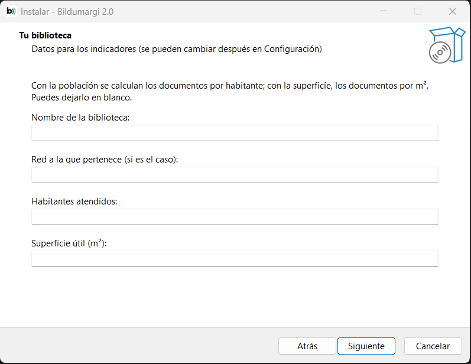
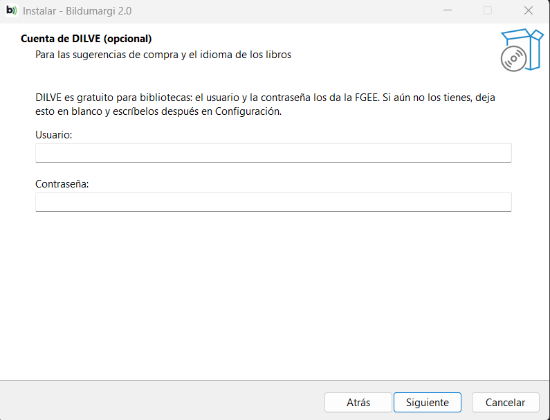
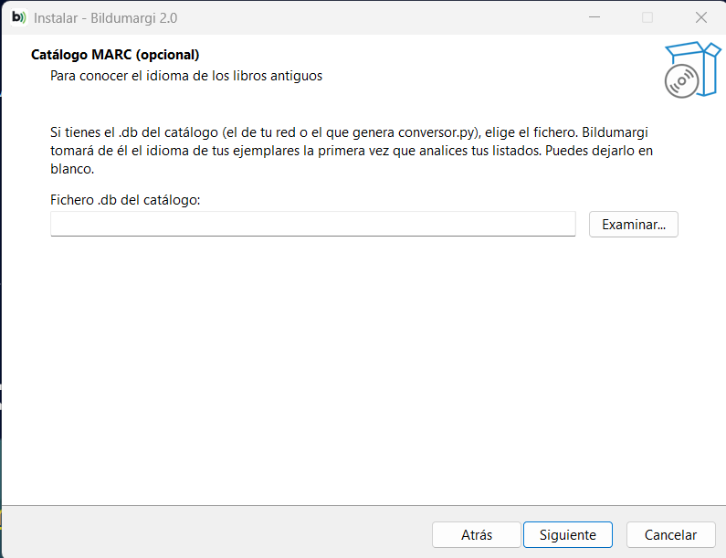

# Instalar en Windows

Bildumargi se instala como cualquier programa: un instalador, un acceso
directo en el escritorio y una ventana propia. **No hace falta Python ni
permisos de administrador.**

## 1. Descarga el instalador

En la [página de versiones](https://github.com/96urkia/bildumargi/releases),
descarga **`Bildumargi-2.0-instalador.exe`** (unos 30 MB).

??? info "Comprobar que el fichero ha llegado entero (opcional)"
    Junto al instalador está su huella `SHA-256`. En PowerShell:

    ```
    Get-FileHash .\Bildumargi-2.0-instalador.exe
    ```

    El código debe ser igual al publicado.

## 2. Ejecútalo

Haz doble clic en el instalador.

!!! warning "«Windows protegió su PC»"
    Bildumargi es un programa libre sin firma digital comercial, así que la
    primera vez Windows avisa. Pulsa **Más información** y después
    **Ejecutar de todas formas**.

El asistente pide, después de elegir la carpeta y el acceso directo, tres
cosas. **Todas son opcionales** y se pueden cambiar después en
[Configuración](../uso/configuracion.md):

1. **Tu biblioteca**: nombre, red a la que pertenece, habitantes atendidos y
   superficie útil.
2. **Cuenta de DILVE**: usuario y contraseña (ver [DILVE](dilve.md)).
3. **Catálogo MARC**: el fichero `.db` del catálogo, con el botón
   **Examinar** (ver [Catálogo MARC](catalogo-marc.md)).







Al terminar, deja marcado **Abrir Bildumargi**.

## 3. Ábrelo

Con el acceso directo del escritorio o desde el menú Inicio. Bildumargi se
abre en **su propia ventana**; al cerrarla se cierra todo.

!!! note "Captura pendiente"
    `img/win-acceso-directo.png` — el acceso directo de Bildumargi en el
    escritorio.

Sigue con [Tu primer diagnóstico](../empezar/primer-diagnostico.md).

## Dónde se guardan los datos

En la carpeta de tu usuario de Windows:

```
%LOCALAPPDATA%\Bildumargi\datos
```

(Para abrirla, pega esa ruta en la barra del Explorador de archivos.) Ahí
están las cargas guardadas, la configuración, lo descargado de DILVE y el
idioma extraído del MARC. Ver [Ficheros y carpetas](../referencia/ficheros.md).

## Actualizar a una versión nueva

Descarga el instalador nuevo y ejecútalo: se instala encima, **conserva tus
datos** y no vuelve a preguntar los datos de la biblioteca.

## Desinstalar

Desde **Configuración de Windows → Aplicaciones**, o «Agregar o quitar
programas». Al terminar pregunta si quieres borrar también los datos: si vas
a reinstalarlo, contesta **No** y los conservarás.

??? question "Ordenadores municipales bloqueados"
    Algunos ayuntamientos no permiten instalar programas aunque no pidan
    permisos de administrador. En ese caso, habla con el servicio de
    informática o prepara una [demo sin instalar nada](requisitos.md#una-demo-sin-instalar-nada).
