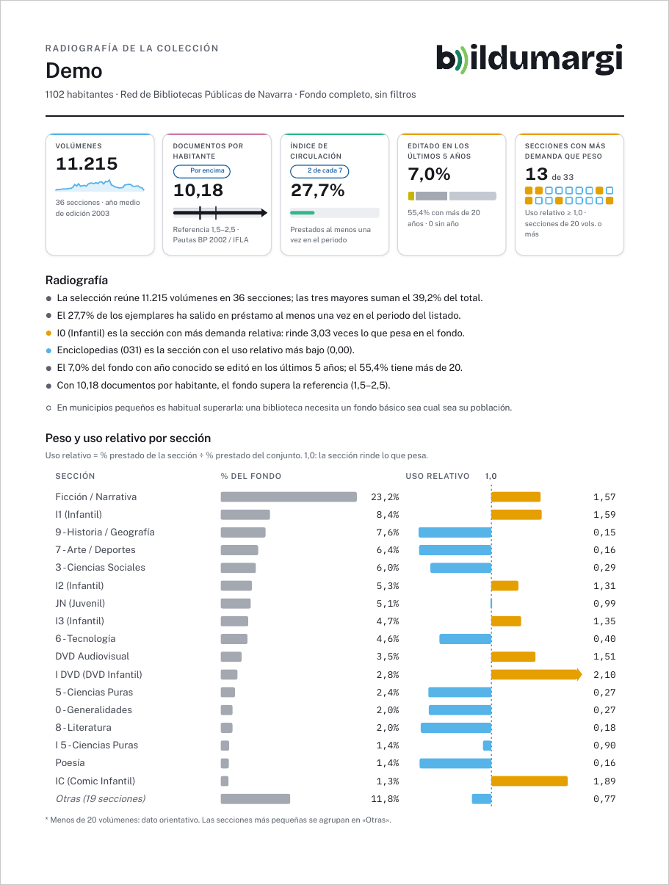

# Informe imprimible

El botón **Informe**, junto a **Cambiar ficheros**, abre una vista previa en
hojas A4 que se imprime o se guarda como PDF, sin conexión a internet.

{ width="600" }

## Qué contiene

Describe el **fondo completo**, sin los filtros que tengas puestos en las
pestañas:

1. **Indicadores** con su referencia, la lectura automática y el peso y uso
   relativo de cada sección.
2. **La colección sección a sección**: volúmenes, peso, préstamo, uso
   relativo, año medio y porcentaje de los últimos cinco años, más los años de
   edición.
3. **Dónde hace más falta comprar**: la matriz que cruza el uso relativo de
   cada sección con su actualidad, y la lista de secciones prioritarias.
4. **Notas de método**: qué es el uso relativo, de dónde sale el préstamo y la
   fuente de la referencia por habitante.

## Cómo guardarlo en PDF

1. Pulsa **Imprimir o guardar PDF**.
2. En el diálogo de impresión, elige como impresora **Guardar como PDF**.
3. Guarda.

El informe se imprime siempre en tema claro. La opción **Para blanco y
negro** usa una paleta de un solo tono, legible sin color.

!!! tip "Para el ayuntamiento"
    El informe está pensado para acompañar una petición de presupuesto o una
    memoria anual: cada dato lleva su explicación y su fuente.
