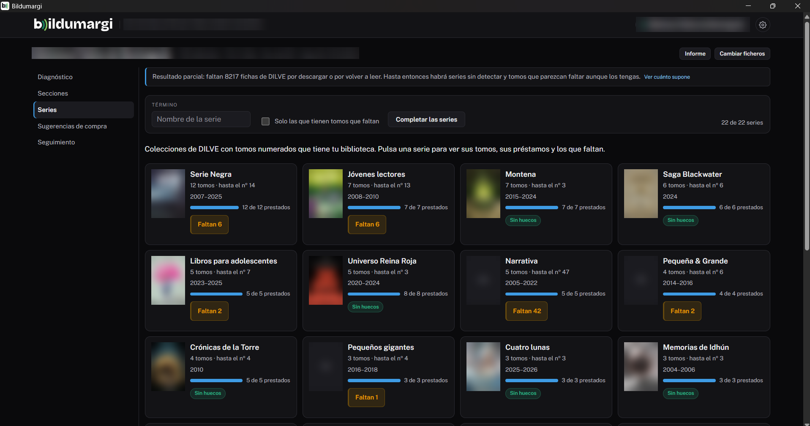
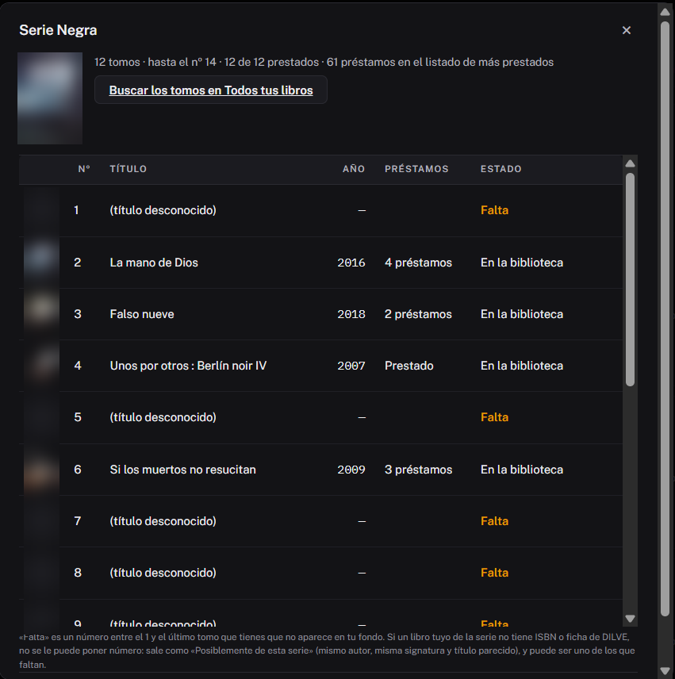

# Series

La pestaña **Series** reúne las series que tiene tu biblioteca («Los
Futbolísimos», «Geronimo Stilton», «Harry Potter»…) y te dice, de cada una,
qué tomos tienes, cuánto se prestan y **cuáles faltan**. Funciona con las
fichas de DILVE de tu catálogo (ver [DILVE](../administracion/dilve.md)).

## Un recuadro por serie

Cada recuadro muestra:

- la **portada** del primer tomo;
- cuántos **tomos** tienes y hasta qué número llega la serie;
- los **años** de publicación;
- una barra con cuántos ejemplares han salido en préstamo;
- etiquetas: **Faltan N** (huecos en la numeración), **N posteriores** (tomos
  más nuevos que el último que tienes), **posibles sin ficha** o **Sin
  huecos**.

Arriba hay un buscador por nombre y la casilla **Solo las que tienen tomos
que faltan**.

## El detalle de una serie

Al pulsar un recuadro se abre la lista de tomos:

| Columna | Qué es |
|---|---|
| **Nº** | El número del tomo en la serie. |
| **Título** y **Año** | De tu catálogo o de la ficha de DILVE. |
| **Préstamos** | Los del listado de más prestados; si no, si ha salido o no. |
| **Estado** | **En la biblioteca**, **Falta** (hueco en la numeración), **Posterior: falta** (con su fecha de publicación) o **Posiblemente de esta serie**. |

Debajo hay dos botones:

- **Buscar los tomos en Todos tus libros**: abre en el navegador el catálogo
  de las librerías (CEGAL) con la búsqueda de la serie hecha. Ahí salen los
  tomos con su número y título.
- **Descargar CSV** con la lista.

## Completar las series

DILVE no permite pedir una serie entera. Por eso, el botón **Completar las
series** pide a DILVE las fichas de los libros que **pueden** ser tomos de tus
series:

- los que las editoriales dan como «otras obras del mismo autor» en las
  fichas de tus tomos;
- los de esos autores en el catálogo de la red, si se extrajo el
  [catálogo MARC](../administracion/catalogo-marc.md).

Cada ficha dice a qué serie pertenece y qué número tiene: así aparecen los
tomos posteriores a los tuyos y los huecos con su título. Además, renueva las
fichas de tus tomos con más de un mes, para recoger los recién publicados.
**Púlsalo de vez en cuando.**

Como en la descarga del catálogo, antes de empezar enseña cuántas llamadas a
DILVE supone y solo empieza si confirmas.

## Cómo se reconoce una serie

En DILVE, la «colección» de un libro mezcla dos cosas: **series** de verdad y
**colecciones de editorial** («Andanzas», «Serie Negra»). Bildumargi cuenta
como serie una colección:

- con al menos dos tomos tuyos **numerados** (hasta el 60);
- cuyos tomos son casi todos **del mismo autor**, o llevan **el nombre de la
  serie en el título** («Minecraft…», de varios autores).

Si se cuela alguna que no lo es, en su detalle está **No es una serie:
ocultarla**. Las ocultas se recuperan en [Configuración](configuracion.md),
apartado **Series ocultas**.

!!! info "«Posiblemente de esta serie»"
    Un libro tuyo sin ISBN o sin ficha de DILVE no se puede numerar. Si es del
    mismo autor, con la misma signatura y un título que empieza como los de la
    serie, aparece aparte como «Posiblemente de esta serie»: puede ser uno de
    los que figuran como «Falta».

!!! tip "Los tomos nuevos se van guardando"
    Cada tomo de tus series que llega en las [novedades de DILVE](novedades.md)
    se guarda para siempre, aunque salga de la ventana de meses. Con el
    tiempo, Bildumargi conoce más tomos de cada serie.
