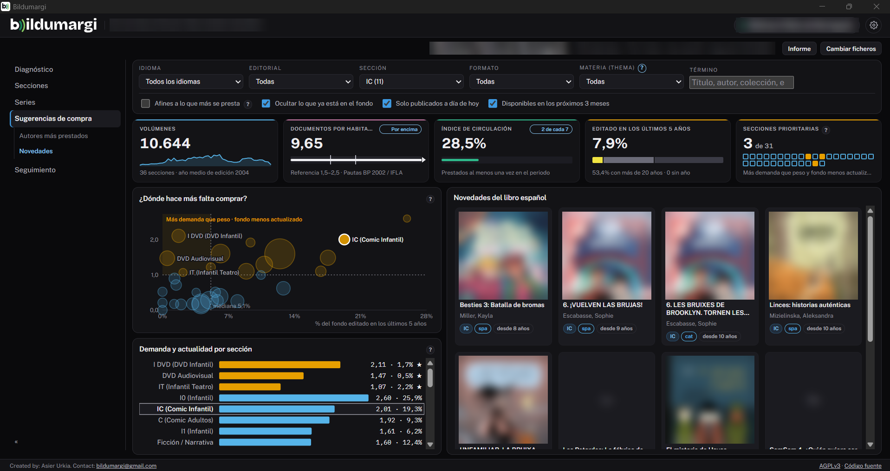

# Sugerencias de compra

La pestaña **Sugerencias de compra** aparece cuando hay una cuenta de DILVE
(ver [DILVE](../administracion/dilve.md)). Cruza la demanda de tu fondo con lo
que se publica.

## El panel de arriba: dónde comprar

Es igual en las dos fuentes:

- **Indicadores generales** del fondo.
- **¿Dónde hace más falta comprar?**: una matriz que cruza el **uso relativo**
  de cada sección (altura) con su **actualidad** (izquierda-derecha). El
  tamaño de cada círculo son los volúmenes de la sección. Las secciones
  prioritarias combinan más demanda que peso con un fondo menos actualizado.
- **Demanda por sección**: el uso relativo y la actualidad de cada sección en
  barras, con las prioritarias primero.

Al pulsar una sección, la lista de abajo se acota a ella.

## Dos fuentes de títulos

En el menú lateral eliges de dónde salen las sugerencias.

### Autores más prestados

Otras obras, a la venta, de los autores que más se prestan en tu biblioteca.
Se cuenta **por autor, con todos sus libros**:

- se toman los autores que suman la mitad de los préstamos de cada sección;
- de **todos** sus libros en tu fondo se piden a DILVE sus «otras obras»;
- primero van los autores que más se prestan y aquellos de los que sale la
  mayor parte de los ejemplares.

Cada propuesta lo explica, por ejemplo:

> Javier Castillo: 8 títulos en tu fondo · 8 de 8 ejemplares prestados ·
> 116 préstamos (el más prestado: «El día que se perdió el amor», 23)

Tiene filtros de idioma, sección y edad. No se repiten ediciones de una misma
obra, y como mucho salen tres libros por autor.

La primera vez se calcula en segundo plano: verás un aviso de progreso. El
resultado se guarda y no se vuelve a calcular mientras tu préstamo no cambie;
para rehacerlo está **Volver a calcular**.

!!! note "Captura pendiente"
    `img/compras-autores.png` — Autores más prestados: lista de obras con la
    explicación por autor (portadas difuminadas en el manual).

### Novedades

Las novedades editoriales de DILVE: ver [Novedades de DILVE](novedades.md).

## La ficha de un título

Al pulsar un título se abre su ficha a la derecha: portada, autoría,
editorial, fecha, colección, sección, idioma, resumen, palabras clave y
materias. Se puede ampliar con el botón de arriba o ensanchar arrastrando su
borde izquierdo.

!!! info "Sin precios"
    Bildumargi no maneja precios ni presupuestos.
